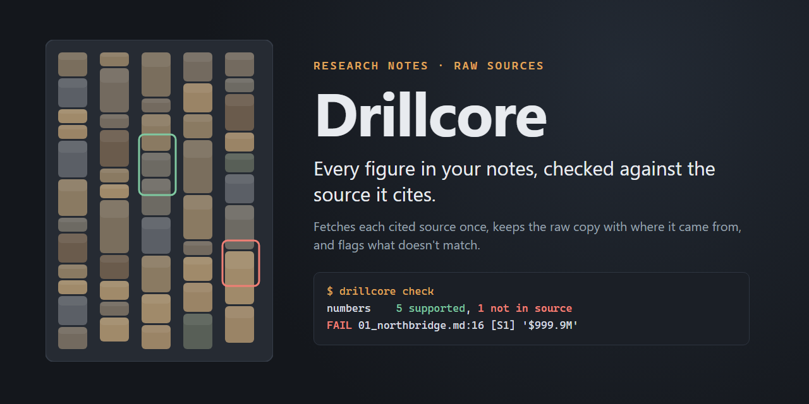
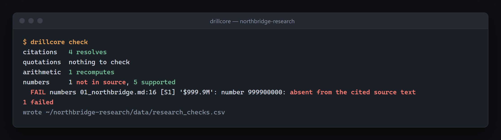

# Drillcore



[](https://github.com/3DTHNeal/drillcore/actions/workflows/ci.yml)

[](LICENSE)

A core is a column of rock pulled straight out of the ground, boxed, labelled with where it came from, and sent to the assay lab. Drillcore does that for research: it pulls the raw sources a set of notes cites, keeps them with where they came from, and checks every figure in the notes against the source it names.

The code is here; the notes, the database and the fetched sources live in a workspace, a folder outside this repository. Everything in this repository's examples and screenshots is fictional.

**[Set it up →](docs/setup.md)** A walk through from a fresh clone to checked notes, with screenshots.

## The goal

Every figure, quotation and calculation in a set of notes should trace to a raw copy of the source it cites, and the ones that don't should be caught before they reach a draft. Drillcore keeps the sources, checks the notes against them, and checks a draft against the notes. It checks what you wrote; it never writes the notes or the report for you.



## What it does now

| Command | What it does |
|---|---|
| `drillcore sources` | Reads the notes and records every URL they cite, with the source key that cites it |
| `drillcore fetch` | Downloads each cited source once, keeps the raw bytes by their hash, and extracts the text. A cited SEC filing index brings in the documents inside the filing. A JSON body is kept, and read as text only when its address is listed under `[sources] read_json`. A CSV body is read as a table, its cells split as a table's are. `--reread` fetches nothing and reads the text again from the copies kept, leaving text gathered by hand as it is. |
| `drillcore sec` | Loads SEC structured facts and filing lists for the companies the workspace names |
| `drillcore index`, `drillcore search 386,154` | Full-text search over everything fetched. Each hit shows the words around it, the keys its document is listed under, and the note lines that cite it, or says no note cites it. |
| `drillcore inventory` | Lists every source with its key, address, fetch date, status (fetched, refused, failed, gathered by hand, imported file, not fetched), hash, text size, whether it's primary or secondary, and the note lines that cite it. A source is primary or secondary when its Sources entry says `[primary]` or `[secondary]`; otherwise an address on a filings registry, such as the SEC's, or on a domain `[sources] primary` lists is primary, and anything else is left unmarked rather than guessed. Writes `data/inventory.csv`. |
| `drillcore figures` | Looks for each figure in the notes in the text of the source its row cites, at the page or section a pinpoint names, and reads the label and period beside it there. Writes what it couldn't confirm to `data/figures_not_found.csv`: a figure not found, found only away from the page cited, or found only beside another period or line. |
| `drillcore conflicts` | For each figure a note takes from one source, reads the tables of every other source the workspace holds for the same label and period, and lists any that state a different figure, naming both sources. Writes `data/conflicts.csv` and exits 1 when it finds one. |
| `drillcore consistency` | Lists each measure the notes and drafts state two ways, by label and period, beyond the rounding each is written to, with where each is. A table column headed by a measure ("Gross margin") is a measure of its own, so two cells of one row aren't paired, and a figure of one company isn't paired with another's: each figure takes its company from its label, its table's lead-in, its headings or the document's title, matched against the companies `[[sec.company]]` names and any `[consistency] entities` lists. A table whose rows are companies and whose columns are measures is read as each company's measure, its year from the line leading into it when no row or column gives one, and a cell "+3.1% (2024); +41.6% (2025)" as a figure for each year. Two figures a whole step apart in their last place (18.4% and 18.5%) are stated two ways. Writes `data/consistency.csv` and exits 1 when it finds one. |
| `drillcore recheck` | Fetches each cited source that has a stored copy once more, under the same client name and pause, and compares by hash: unchanged, changed (with a short diff of the extracted text), markup changed (same text), gone (404/410: the Internet Archive's closest copy is recorded as a second address), refused (recorded, nothing tried in its place) or failed. The copy the notes were checked against is never replaced; each recheck is a row of the `rechecks` table and the new copy sits beside the old in `data/raw/`. Exits 1 when a source changed or is gone. |
| `drillcore newer` | Warns when a note cites a periodic SEC filing (10-Q, 10-K, 20-F, 40-F or an amendment) that a later periodic filing from the company follows, and when a later filing gives a different value, for the same concept, unit and period, to a fact the notes use: one tagged in a cited filing at a value a line citing it writes, or one `checks/xbrl_claims.csv` names. Gives both values and both filings, writes `data/newer_filings.csv`, and always exits 0. |
| `drillcore claims` | Compares the headline figures listed in `checks/xbrl_claims.csv` with the fact the company itself tagged for that concept and period. Exits 1 on a mismatch. Then works each of the notes' worked-out figures whose inputs are all such claims again from the facts as filed, and warns of those that no longer come out to the place written (`data/workings_as_filed.csv`). The year a table row names, or the order of a "2010 to 2025" total, settles which of a company's claims an input is when two share its size; a sum on a year row may add several companies' figures; and an input that is another working's result, on its own line or uniquely on an earlier one, takes what that working comes to as filed, so a ratio of two sums and a figure carried down a chain of workings are read too. |
| `drillcore check` | Four checks on the notes, each against the sources a line cites: every source key resolves to an address, every quotation appears word for word, every worked-out figure written as arithmetic recomputes, and every number in a sourced row passes the assay's number check. Also warns when a figure stands in its source away from every word its row describes it by, and when an input of a worked-out figure traces to nothing. Says how much of the notes it held to a source, and, for each section `[[check.sections]]` names, whether enough lines under its heading were. Writes what didn't pass to `data/research_checks.csv` and exits 1 on any failure that no waiver accepts, or when nothing was judged. `--strict` exits 1 on any warning or anything not judged as well. |
| `drillcore citations` | Checks that every source key a note cites has an entry in its Sources list (or the list of a note it borrows from), that each entry gives a URL, and that each URL was fetched or its text gathered by hand. Warns about entries nothing cites. Exits 1 on an error. |
| `drillcore quotes` | Looks for each quotation in the notes (double-quoted text and blockquotes) word for word in the source it cites, evening out only quote marks, dashes, whitespace, line-break hyphens and the case of the first letter, leaving alone a quotation of a document `[check.quotations] not_sources` names, and writes what it couldn't confirm to `data/quotes_not_found.csv`. Exits 1 when a quotation isn't in its source. |
| `drillcore arithmetic` | Recomputes each worked-out figure from the working written beside it, as "-3.7% (551.1 against 572.5)", "70.8% (67.5 of 95.4)", "$27.9M (= 95.4 - 67.5)" or, for a rate, "-0.4pp (2.7 against 3.1)" or "+25bp (from 4.25% to 4.50%)", or as an equation (`a + b = c`, or a table's Result and Arithmetic columns, allowing for the rounding of its inputs), and reports any that don't reproduce. It also recomputes a currency conversion written with its rate, `$510M (RMB 3.7bn at 7.25)`, and foots tables: each column adds to its Total (or Consolidated/Group) row, and a column of shares to no more than 100%. A working is read by a small math engine of its own: it knows powers, `sqrt`, `ln`, `exp`, `avg`, `median` and the like, named formulas such as `cagr(450.0, 551.1, 5)` (or "4.1% (from 450.0 to 551.1 over 5 years)"), and figures the notes' tables state, named in braces: `41.2% (= {Gross profit 2025} / {Revenue 2025})`. A workspace can set rules the figures must keep to wherever the notes state them, as `{Gross margin} = {Gross profit} / {Revenue}`, under `[[arithmetic.rules]]`. Exits 1 on a wrong one. |
| `drillcore overlap` | Finds every run of 12 or more words (`--min-words` to change it) that a draft in `drafts/` shares with a fetched source, leaving out quotations, blockquotes, in-text citations, the draft's reference list and the sections `[drafts] records` names, and writes them to `data/overlap.csv`. Exits 1 when it finds one. |
| `drillcore assay [DRAFT ...]` | Judges each draft in `drafts/` (Markdown, or a Word document or PDF read as text) against the notes with the assay. Every number, percentage, multiple and spelled-out number must be in the notes as written, or in the unit a line's label or a table's heading states (`US$ millions: 418.6` holds `$418.6M`); one that rounds a figure the notes give more exactly (7.4% of 7.36%) passes with its reason; one only a cited source holds is a warning, and so is one the notes hold only on lines that share no word with the draft's sentence, which names the notes' nearest lines. A title or credential must be one the notes give, read whole, or it's a warning. Every web address, domain or email must be one the notes write. Names listed under `[assay] forbidden` must not appear however they're split, except where `[assay.allowed]` lets them stand (captions, source lines, the reference list, citations); a sentence matching `[assay] unsupported` fails unless it denies it, and one matching `[assay] judgments` fails unless it's attributed or cited. With `[assay] cutoff` set to the day the data were closed, a plan or expectation dated to a period already begun by then ("planned to open ... in the second half of 2026") is a warning. Each verdict is sealed to the exact draft, notes, sources and rules. Writes `data/assay.csv` and exits 1 when a draft fails. |
| `drillcore proof` | Proofs each draft against itself and the workspace: every author-date citation names an entry of the reference list (the draft's own, or the files `[proof] references` names), with no entry twice; a narrative citation, "Roe et al. (2023) argue", of an author the list has must give a year the list has for them, and "Doe et al. (2024)" must name an author it has (warnings, since a company's name before a year in brackets may be the company in that year); an author's works in one year are lettered a, b, c in the order listed, and a work alone in its year has none (each finding gives the year it should have, so together they're the fix); entries nothing cites, and ones whose address is no source the notes cite, are warnings, unless `[assay.accept_addresses]` accepts the address; a figure in a sentence citing a source the notes hold must be in that source's text (a warning), unless the sentence labels it as the author's working ("author's calculation from ...", "summed by the author") and a worked-out line of the notes gives it, which passes and names the line; a source line naming a company's "annual reports on Form 20-F for fiscal 2010 to 2025" must match the filing list `sec` loaded for it; "section 5.3", "Exhibit E12", "Appendix B" and "entry 50" must name a heading, caption or entry the drafts or `[proof] companions` give; a record's entries (a `[drafts] records` section or a companion) are numbered once each and in order; a record compiled from a log (`[[proof.record_logs]]`, such as an appendix of AI-use citations) has every entry the log has, each date, address and quotation as the log gives it, and each prompt the log quotes quoted, unless a `cuts` file says why it was left out; with `sessions`, a folder of the AI assistant's own session transcripts, each prompt typed in them is in the log or a cuts file (a session with none there is reported as one with no entry), and each prompt the record quotes is the whole of a typed message or marks its cuts; each exhibit is captioned once and mentioned; each figure of the executive summary is given somewhere else in the drafts, and each figure of a sentence that points to "(sections 2.1 and 4)" is given there, on a line about the same thing, and, for a sentence that cites nothing, given there with a source (warnings); a table's Total column or row adds up, and so does a total stated in prose; a framework's table keeps the rules `[[proof.table_rules]]` sets, what a column may hold and an outcome derived from the others; a date in a sentence later than every work it cites, unless a cited source's text gives it, and a sentence saying "nothing published after" a day while the drafts cite works dated after it, are warnings (`dates`); an author a source line names in prose ("annual reports of Acme Corp.") needs an entry in the list; "the Appendix" where the appendices are lettered is a warning, and so is "that date" or "that day" where the sentence and the one before give two dates; and no local path, email, account handle or `[proof] personal` term appears, except those `[proof] allow` lists; and in the sections `[proof] workspace_sections` names, each figure about the workspace's own record ("30 documents with stored text", "412 judged", "18 match") must be the database's value now or the last `check` or `claims` run's, an earlier run's value is a warning naming it, a "Not judged:" breakdown must add up to the run's total (counts in brackets break a part down and add none), and a count must be called what it counts: "Figures held to their source: 412 judged" fails when quotations are among the 412, "12 lines that cite no source" when the 12 stand on fewer lines, and "8 sums" when most of the 8 are workings (`check` keeps its counts, and what each is made of, for this). Writes `data/proof.csv` and exits 1 on a failure; `--all` lists the passes given with a reason too. |
| `drillcore trace 551.1`, `drillcore trace 01_northbridge.md:7` | Shows where a figure came from: each draft line that states it, the note row that holds it, the source key it cites, the address with its fetch date and hash, and the passage in the stored copy with the figure marked. Says where a chain stops when a link is missing, and exits 1 when no chain reaches a stored passage. |
| `drillcore review` | Opens a page in the browser, served on this computer only, that steps through every claim `check` judges, with the note on one side and the stored source it cites on the other. Each figure, quotation and worked-out figure is coloured by its verdict, and the source opens at the passage that holds it: the figure marked at whatever scale it was found, the row's words underlined near it, and the page or section a pinpoint cites shaded. A correction the source or the working itself gives is offered, to apply with a key and undo: the source's words for a quotation a word off, what a working gives, or the page a figure is really on. Each claim can be marked as matching its source or disagreeing with it, saying how, in `checks/review.csv`, and a failure or warning accepted with a reason, as a row of `checks/waivers.csv`. Lines can be edited in place, and the checks run again. See [Reviewing by hand](#reviewing-by-hand-review). |
| `drillcore evidence [DRAFT ...]` | Writes a page for each draft to `data/evidence/`, in which every figure and quotation links to the passage in the stored source that backs it, highlighted, with address, fetch date and hash. The last findings of `assay` and `check`, with any waiver, sit beside the lines they concern. Built from the stored copies only: nothing is fetched. |
| `drillcore names` | Lists each proper name the notes and drafts spell more than one way (spacing, hyphens, accents, case, or a letter or two in a long name), with where each spelling is written, and writes `data/names.csv`. Output to a pipe or file is UTF-8, so a name such as "Büro" or one in Chinese prints as written. `[names] preferred = [...]` holds a name to one spelling, however it's split or joined. Leaves out quotations, Sources lists, code and addresses. The report's companion parts (`[proof] companions`) are read too, and a reference list is left out. Exits 1 when a name has more than one spelling. |
| `drillcore export-sources`, `drillcore import-sources FILE` | Writes every note's Sources list as BibTeX (`data/sources.bib`) and CSL JSON (`data/sources.json`), keyed `note:S1`, with the fetch date as the access date; `--format bibtex` or `--format csl` writes one. Reads a BibTeX or CSL JSON export and writes proposed entries to `data/proposed_sources.md`, never to the notes. |
| `drillcore import-text` | Loads page text gathered by hand, for a site that refused the fetch or a page the fetch read no text from. A refusal stays recorded as one; a fetch that succeeded isn't marked as refused. |
| `drillcore import-file PATH --key S7 [--note NOTE]` | Keeps a local file with no public address (a PDF from a data room, an email) as the source behind a key: stores it by its hash, reads its text as a fetched file's would be, and records where it came from. A Sources entry can name it as `file:deck.pdf` in place of a URL. The file is read, never run. |
| `drillcore where`, `drillcore init` | Shows or makes the workspace |

`figures` says a figure is found when the number appears in the cited source as written, at another scale (551.1 in the notes, 551,102 in a filing stated in thousands), or with more decimal places. That is a loose test, so it then reads what the number sits beside, in the source and in the note: in a table, the row's label and the column's heading; elsewhere, the clause around it. Periods are read from words such as `Q3 2025`, `3Q25`, `nine months ended September 30, 2025`, `H1 2025`, `FY2025` or `calendar 2025`, and as economic data names them, `October 2025`, `Oct-25`, `2025Q3` or `2025M10` (a date such as `October 28, 2025` isn't a month). A label's qualifiers tell two lines apart: gross, operating or net; basic or diluted; restated or as reported; adjusted or not; before or after tax; and for economic series, real or nominal; core or headline; seasonally adjusted or not; a change on the year, quarter or month (`y/y`, `q/q`, `m/m`); a forecast or an outturn. A figure the source calls a forecast or projection, where the note states it without saying so ("expects", "sees", "is projected to" and the like), is reported as beside another line. A figure the source holds only beside another period or another line is reported as such. A comparative in brackets, as UK and European reports give the prior year, "£551.1m (2024: £572.5m)", is read as a clause of its own: its year is the bracketed figure's, never the one's before it, in a source and in the notes, and `consistency` reads this year's figure from such a sentence rather than passing it over. One place whose words can't be read leaves the figure found, since it may be the place the note means: nothing is guessed. `claims` is the strict test.

### Pinpoints

A key can name the page or section it's read at: `S1 p.47`, `S1 pp.47-48` or `S1 §Note 12`. `figures`, `quotes` and `check` then hold the row's figures and quotations to it, and one the source holds only elsewhere is reported as not on the page, or not in the section, cited (a failure for `quotes` and `check`).

- A PDF's pages are kept as it's read. `p.47` is page 47 counted from the front, or the page printed 47 on a line of its own at its top or foot: what's on either counts.
- A section is a numbered heading, such as `Note 12`, `Item 7` or `2.3`, found as a line that starts with it, and runs to the next line starting a section numbered the same way. A contents page starts the same lines, so each counts.
- A pinpoint that can't be read isn't judged: a page on a source with no pages, a section named by words alone or missing from the source, or a PDF kept by an older version (`fetch --reread` reads it again with its pages).

### What `check` holds the notes to

Each result passes, fails, is a warning, or isn't judged. A line that names no source, or cites one whose text was never fetched, isn't judged: that's neither a pass nor a failure. A Sources entry nothing cites is a warning. Each warning is listed, and the run says how much of the notes was held to a source at all, as `held to a source: 41 judged (12 quotations, 29 checks of figures), not judged: 6 no source key`. The count is of checks, not of figures: quotations count, a row whose figures are all found counts once, and each figure warned about counts again. When nothing was, as before the first `fetch`, `check` says so and exits 1: "0 failed" from a run that judged nothing would say nothing.

The count is for the notes as a whole. A workspace can also name sections that must rest on a source, with how many lines under each must be held to one:

```toml
[[check.sections]]
notes = ["*_industry.md"]
headings = ["Rivalry", "New entrants", "Substitutes", "Buyer power", "Supplier power"]
min_sourced = 2
```

`check` then fails a section with fewer (`thin`), and a note the rule covers that lacks the heading (`section_missing`). A section whose lines wait on a source not yet fetched isn't judged, and a rule that covers no note is a warning. A heading matches on its words, without its number, case or the keys in brackets at its end, and a section runs to the next heading at its level or above. A line counts when a quotation or figure on it was judged against its source, passed or not, and a worked-out row counts once its inputs are traced. The headings are the workspace's own: no framework is supplied, and nothing is written into a note.

`check --strict`, or `[check] strict = true` in `workspace.toml`, holds the notes to more: every warning and everything not judged is listed, and the run exits 1 unless each one passes or a waiver accepts it. A quotation of a document the workspace says isn't a source stays outside it.

The first three checks are the ones `drillcore citations`, `quotes` and `arithmetic` run, and `check` reports what they find, with one difference: a source that hasn't been fetched, or whose fetch failed or gave no text, is an error for `citations` and isn't judged by `check`, where a citation stands on its key having an address.

A source that is JSON (a price series, a data service's answer) is kept but not read as text unless `workspace.toml` lists its address:

```toml
[sources]
read_json = ["https://example.com/northbridge/prices.json"]
```

That's a choice because one address of a data service often stands in a Sources list for figures the service serves from many files. Those figures are `claims`'s to hold, against the structured facts, and read as text the one file would be all its rows were judged by. Unlisted, a row citing only that address isn't judged, as before. Listed, `fetch` writes each value in the file as a line of text, in the characters the file writes it in (`prices | date: 2026-01-02 | close: 12.300000190734863;`), and the rows citing it pass or fail on it like any others. A copy fetched before the address was listed is read by the next `fetch` from where it's kept, without fetching it again or reading any other source again, and the text of an address taken off the list is dropped. When a row cites a source with no text beside one that has it, a figure the readable one doesn't hold still fails, and the failure names the source that wasn't read.

- **Citations.** A word shaped like one of the note's own keys (the same letters and a number, or the usual S) must have an address in the database, from the note's Sources list or the one note it borrows from. A line can also name another note's list outright: `(file 04 sources S41, S44)`. An entry in a Sources list must give an address.
- **Quotations.** Words in quotation marks, however few, and blockquotes must appear in the text of a source the line cites, after the same reading the assay gives text (accents, look-alike letters, HTML comments and emphasis folded) and with curly marks, dashes, line breaks and a word hyphenated across a line read as plain ones. An ellipsis or square brackets split a quotation into parts that must appear in order. Two changes quoting allows are undone: the case of the first letter, and punctuation closing a part, such as a full stop inside the closing mark. Nothing else is forgiven, so a word left out without an ellipsis, or a heading quoted in other capitals, fails, and a miss says how far the quotation matched and whether it would match without capitals. Notes that quote a document which isn't one of their sources, such as a brief they answer, can say so in `workspace.toml` with `[check.quotations] not_sources = ["brief"]`. A quotation whose sentence or clause names that document, which sits in a table column whose heading names it, or a blockquote whose lead-in names it, is then not judged. When the note says who said a quotation (a name, or a role such as "the chief executive") and the source names that person, but not within a few hundred characters of the passage, the quotation is a warning (`not_near_speaker`): the words are right, the speaker may not be.
- **Arithmetic.** On a row marked as worked out, a figure with its working in brackets, as "-3.7% (551.1 against 572.5)", "70.8% (67.5 of 95.4)" or "$27.9M (= 95.4 - 67.5)", must reproduce from that working to the figure's last decimal place. Anywhere in a note, an equation, `a + b = c` or `c = a + b`, or a table row with a Result and an Arithmetic column, must recompute to the precision its result is written to, allowing for the rounding of its inputs. Rows marked as worked out whose arithmetic is written neither way are listed as not parsed, never guessed at. A conversion with its rate in brackets is recomputed, the rate read as the bracketed currency to one of the figure's unless written `at 0.138 $/RMB`; one with no rate is not parsed. A table's Total row must be the sum of the rows above it, allowing for each cell's rounding; a cell it can't read leaves the column not parsed. Only a row labelled just Total, Consolidated or Group fails when it doesn't add up: a "Total debt" in a table of key figures is a figure of its own, so one that doesn't add up is shown as not parsed.
- **Numbers.** The assay's number check, with its `MEASURED` policy, judges each sourced row against the text of the sources it cites. Dates, a year, `9M 2025` and identifiers such as a CAS number are set aside first, since they measure nothing. Three things are read before the assay judges a row:
  - A figure a Chinese page counts in ten-thousands or hundred-millions is written out in full, in the source and in a note that repeats its characters, so `RMB 3.7bn` is held to the page's 37亿 and to nothing that only shares its digits.
  - A table that states its unit once, as its first heading (`US$M`), in the line leading into it ("US$ millions except per share") or in a heading above it ("### Costs (US$ millions; S1)", until the next heading of that level), has each bare cell past the row's label judged as written and again in that unit. A cell passes on either reading, so 6.2 is supported by a release's "$6.2 million" and a per-share figure in the same table is still found as it stands.
  - A source's line ends are read as one character each, so a sentence a PDF wrapped between "$31" and "million" still states one figure.

  A figure of fewer than three digits is never matched across scales: 2.6 isn't the 2,612 of a table in thousands, since any 2,6xx would do. Write it as the source does, or to the digits the source gives. A figure the check doesn't find comes with what the looser `figures` test makes of it: at another scale, in the digits of a Chinese page, or nowhere.

  A figure the source holds isn't yet a figure the source gives for the thing the row names. So each figure of three digits or more that passes, and each percentage of two (4.3%, where a release gives several rates of 4.3%), is found in the source, and when none of the row's words, or its table header's, stands within 250 characters of any place the source gives it, the figure is a warning (`not_near_label`). A row reading "Net income was $12.4M" against a source whose $12.4 million is a net loss is one. Common words (dates, "total", "rose", "fell", "rate", "percent") aren't counted, and a word matches on its first five letters. This catches a figure taken from the wrong place, not every wrong label: a competitor's revenue, given beside the word "revenue", still passes.

  A worked-out row's own figures are the arithmetic check's, but the inputs its working starts from must come from somewhere. Each must be written in a row of the notes this check judged (and not one it failed), be the result of another working that recomputes, or be held by a source the worked-out row cites. One that's none of these is a warning (`input_not_traced`): "+12.0% (640.2 against 571.6)" recomputes whatever 640.2 and 571.6 are. One written only in a row that wasn't judged isn't judged either. A whole number of 12 or under and a power of ten are constants, such as months or a unit, and an input is matched on its digits.

Every command runs with nothing installed. The assay, the fact checker `check` and `assay` use, is in `tools/assay` and is the standard library only too.

### What `assay` holds a draft to

The notes are a draft's fact bank, so `assay` holds a draft to them the way `check` holds the notes to their sources.

- **Numbers.** Each figure must be in the notes at the same value and scale. One that only a source the notes cite holds is a warning: it rests on a source, not on the notes. A figure written with a scale letter after a space, as in `212 K`, could be a temperature or $212,000, so the notes must write it the same way or hold it at that scale (`$212K`, `212,000`): a bare 212 in the notes doesn't support it.
- **What a figure is for.** A figure the notes hold may still be one they give for something else: "The order backlog was $551.1M" when the notes' $551.1M is revenue. So each figure of three digits or more (a percentage, of two) is looked for in the lines of the notes that state it, and when none of those lines, with its heading and its table's header, shares a word with the draft's sentence, it's a warning. Words are compared as `check` compares a row with its source: on their first five letters, without common ones such as dates, "total" or "rose". An abbreviation joined by an ampersand, such as R&D, M&A or P&L, is a word here too. A sentence with no such word has nothing to compare and isn't warned about.
- **What the notes say a figure is.** On the lines that give a figure for what the draft's sentence names, the notes may say more than its value, and a draft that drops it is warned of. A figure one of them works out from rounded inputs that `claims` matched to the SEC's facts, where the facts as filed give another last digit and no line states it from a source, is a rounding of rounded figures: the warning says what the facts as filed give. A figure in a table whose row names nothing ("| 2022 | 651.5 | -4.5% |") is read with its column's header and the caption above the table, where its sentence alone binds no such working; and a figure in a row or under a caption that names its year binds only a working on that year's row. An amount every such line gives as a change ("$3.8M of incremental duty cost") is warned of where the sentence has no word of change ("duties cost $3.8M"). And a figure every such line gives as someone's estimate or claim ("a 10x estimated cost saving") is warned of where the sentence neither says whose it is nor names a source in brackets.
- **Titles.** A title in a draft must be one the notes give, read whole: it may leave words out ("Senior Engineer" of "Senior Software Engineer"), but not one that lessens it ("Assistant", "Deputy", "Vice", "Acting" and the like), and it may not take words from two titles. "Chief Financial Vice President" from a chief financial officer and a vice president is a warning, and so is "President" when the notes give only a vice president. A credential, a run opening with Certified, Chartered, Licensed, Registered or Accredited, must be in the notes word for word. A title is a run of capitalized words ending in a role, such as Engineer, Director or Officer, with what follows "of" or "for"; a single word counts only away from the start of a sentence.
- **Names.** A name under `[assay] forbidden` is blocked however it's split, joined or pluralized, and with digits written for letters that look like them: `K3str3l` is Kestrel. The first letter must stay a letter, and two digits in a row are a number, so `8017` is never a name.
- **How a figure is written.** A figure is read as a writer states it. A unit given once, by a line's label ("COMPUTED, US$ millions: ... 418.6"), a table's first heading or lead-in, a column's heading ("Cost ($M)") or a heading above the table ("(US$ millions; S1)"), applies to the bare figures under it, in the notes and in a draft. "Tenfold" is 10x and "two-fold" 2x, in either. "The nine figures accepted" is a count, not the idiom for a nine-digit sum, which "earns six figures" and "a six-figure salary" still are. A figure written to two digits or more that rounds one the notes give more exactly, at the same scale (7.4% of 7.36%, $38M of $37.6 million), passes and says which figure it rounds; `--all` lists those passes. So does a bare cell of a draft's table that rounds one in the unit the table states: (8.4) under "US$ millions" of the notes' (8,437) in US$ thousands. Thousands grouped by spaces ("58 000") are one number, and in a table that names its currency in its first heading cell, a column's heading or a row's label ("Line (EUR)"), 46.3m is in millions; elsewhere 1.5m may be metres and is read bare.
- **A figure given another way.** When the notes give a draft's figure only bare, in a table or line that states no unit, or written another way ("18.2m" in a table that names no currency), on a line sharing two describing words with the draft's sentence, the finding names that line and says to state the unit there, in place of a source that happens to hold the figure or the notes' lines about other things. The verdict is what it would have been.
- **What isn't judged.** A draft's reference list, under a heading such as "References", isn't judged for figures, titles, claims or judgments: its years, page ranges and filing numbers are no claims of the draft's, and `proof` reads its entries. Its addresses are still judged; the SEC's structured data for a company `[[sec.company]]` lists counts as one the notes write, since `claims` holds the notes to it. A section `[drafts] records` names by heading, such as a log of prompts quoted word for word, is judged for forbidden names alone; `proof` and `overlap` leave it out too.
- **Links, claims and judgments** are as the command list says. `[assay] judgments` lists opinions as regular expressions; a sentence that makes one passes only with an attribution (`[assay] attributions`, by default phrases such as "in the author's view", "the author's judgment", "chosen by the author" or "we estimate") or a citation.
- **Names allowed in places.** `[assay.allowed]` gives a forbidden name the places it may stand: `"Kestrel" = ["captions", "sources"]`. A caption is a line opening "Exhibit E1." or "Figure 2:", or an image's description; a source line is what follows "Source:"; `references` is under a References heading; `citations` is inside an author-date citation. Anywhere else the name fails as before.
- **Plans dated before the cut-off.** `[assay] cutoff = 2026-10-31` gives the day the data were closed. A sentence with a verb of planning or expecting ("plans to", "planned", "expects", "expected to", "scheduled", "will") that dates it, after that verb, to a day, month, quarter, half or year already begun by the cut-off is a warning: by then the plan had partly happened or slipped, and the draft should say which. "By 2026" is a deadline, warned of only once it's past. "The plan" and "expected growth" are no verbs, and a citation's year is passed over. The setting is part of the seal.
- **Addresses accepted.** `[assay.accept_addresses]` names a web address the notes won't write, such as an article's DOI cited for a framework, with why: `"https://doi.org/10.0000/frames.2019" = "a framework article"`. It passes in a draft with that reason, and `proof` passes a reference entry whose address it is. Each is matched whole, so a domain accepts that domain written alone, never every page under it. The setting is part of the seal.

What it can't catch, and why each choice was made, is in [docs/design/assay-gaps.md](docs/design/assay-gaps.md).

### What a source can't do

A source is written by someone else, who may write it to be read by this tool, or by a person or an agent reading this tool's reports, differently from how a reader of the page sees it. Everything a source holds is data: stored, read and compared, never run or followed. Beyond that:

- **What a page hides isn't its text.** An element with the `hidden` attribute, or an inline style of `display: none`, `visibility: hidden` or `opacity: 0`, is left out with everything inside it, so a figure or quotation planted out of sight can't pass a check. Text hidden by a style sheet's rules, by colour, by size or by position is still read, and so is a PDF's invisible text layer, which a scanned PDF needs.
- **What a terminal would act on is taken out.** Control characters (an escape sequence can clear a screen, rewrite a line or set the clipboard), direction overrides and invisible marks are dropped from a source's text as it's kept, and from anything `search` and `fetch` print. `search` marks each snippet as source text.
- **A page is read in the encoding a browser would use.** A page naming UTF-7 or an escape codec as its encoding is read as UTF-8 instead, since those turn plain-looking bytes into markup or control characters.
- **A redirect stays on the public web.** A cited address may redirect only to another `http` or `https` address on the public internet, never to this machine, a private network or a cloud's metadata service, and the usual pause comes before it.
- **Only the SEC's own archive adds sources.** A filing index brings in the documents it lists only when it was cited, and served, at `www.sec.gov/Archives/`.

A source can still hold any figure in plain sight, and `figures` will find it there: that's why it's the loose test, and `claims` the strict one. Text kept by an older version is read again, without fetching, by `drillcore fetch --reread`.

### Accepting a finding: waivers

Some findings are judged and accepted: a source that rounds differently, a figure confirmed by phone, a quotation of a translation. Rather than change the notes, write a row in `checks/waivers.csv`:

```
check,note_file,line_no,item,reason,accepted_by,accepted_on
numbers,01_northbridge.md,,$999.9M,Confirmed by phone with the company's press office,A. Researcher,2026-11-11
```

`check` is citations, quotations (or quotes), arithmetic, numbers (or figures) or sections, whose item is the heading and whose waiver lapses when any line of the section changes. `item` is what the report names: the key, the quotation, the working or the figure, of which only the digits count. `line_no` may be blank, since lines move. `check`, `citations`, `quotes`, `arithmetic` and `figures` then report the finding as waived, with its reason, and don't exit 1 on it.

A waiver holds for what it was judged against. The first run that applies it records the hash of the line in the notes and of the text of the sources that line cites; when either changes, the waiver lapses and the finding is reported again, saying what changed. To accept it again, change `accepted_on`. A waiver that matches nothing is a warning: the finding may have been fixed.

### Reviewing by hand: `review`

`check` judges each line against its sources, and a person still has to look: a figure the source holds may be its figure for something else, and a quotation that fails may be one word off. `drillcore review` serves a page on 127.0.0.1, at port 8801 unless that's taken, and opens it in the browser. The list on the left holds every claim `check` judged: each figure of a sourced row, each quotation, each worked-out figure, each input of a working not traced, each section a rule names, and each citation that didn't resolve. A citation that did is a link in the note, which opens its source. The note is in the middle, every claim coloured by its verdict, and the stored copy of the source on the right, at the passage that holds the claim. The page reads the stored copies only and fetches nothing.

- **What's marked in the source.** The figure, found the way `figures` finds it: as written, at another scale or with more decimal places, everywhere the source holds it, with the place the pinpoint names first. The words the row describes the figure by, within `check`'s 250 characters of it, or failing that, the first places the source uses them. The page or section a pinpoint cites, and each page's start in a PDF. For a quotation, its words in the source, matched in any case and across line breaks so a reader finds the passage; whether they're exact is still `check`'s to say. For a quotation not found, the passage of the source that keeps the most of its words in order.
- **Corrections offered.** Only a correction the source or the working itself gives is offered: for a quotation not found, the words the source has at its closest passage, when that passage keeps at least half the quotation's words (none for a quotation with an ellipsis or an insertion); for a worked-out figure written with its working in brackets, the figure the working gives, to the places written (none for an equation or a total, where which figure is wrong is the person's to say); for a figure or quotation on another page than the one cited, the page the stored copy holds it on. Each shows the change word for word and the line as it would read, and is written only when the person applies it. The page refuses to write a line that has changed on disk since it was shown, and undoes each change in turn.
- **Marks.** A claim marked as matching its source, or as disagreeing with it with what the source says instead, is a row of `checks/review.csv`: the note, line, check and item, the mark, the comment, who and when, and the hash of the line and of the text of the sources the claim cites. A mark is found again on a line that moved, and when the line or a source's text changes it asks to be looked at again. The file is data, read and written by the page, never run.
- **Waivers.** A failure or a warning accepted on the page is a row of `checks/waivers.csv`, naming its line, with the reason and who accepted it, as one written by hand would be.
- **What reaches the page.** The server answers only requests naming 127.0.0.1 or localhost as their host, and only those carrying the token the page was given when it loaded, so another site open in the browser can't read the notes or change them. The page runs only its own script and style, and shows every note and source as text. On the example workspace nothing is written.

### What changed since the last run

`check`, `figures` and `assay` keep each run's findings and compare the next run with them. New findings are listed first, fixed ones are named, and unchanged ones are counted but not listed. `--all` lists every finding. A finding is known by what it is, not its line number, so editing a note above it doesn't make it new.

## What a workspace looks like

```
workspace.toml          settings: where the notes are, which notes borrow another's source keys, which companies
research/*.md           the notes: figures in table rows and bullets, each row naming its source by key
checks/xbrl_claims.csv  headline figures to hold against SEC facts
checks/waivers.csv      findings accepted, each with why, who and when
checks/review.csv       claims a person marked, on the review page, as matching their source or disagreeing with it
drafts/*.md             drafts to hold against the sources; the folder, the shortest run and the sections that are
                        records are set under [drafts]
data/drillcore.db       the database
data/raw/               one file for each page fetched, named by its hash
```

In the notes, a "Sources" section gives each key its address, as `- **S1.** ... https://...`. A row cites a key by writing it, or inherits the keys named in its section's heading or lead-in. Rows marked COMPUTED or derived are arithmetic and aren't looked for in a source. `example/` has a small fictional workspace.

## What comes next

- `drillcore assay` running `check` first, so a draft is only judged against notes that pass.
- Registries beyond the SEC, one at a time: UK, EU (ESEF) and Asian filings and tagged facts, held to the same fetching rules.
- `conflicts` reading a source's prose as well as its tables.
- `proof` judging a narrative citation of two authors the list doesn't have, "Smith and Jones (2023)", which today it passes over, since "Sales and Marketing (2024)" reads the same way.
- `review` stepping through a draft's claims as well, each beside the note row and the source passage behind it, as `evidence` links them.
- `check` reporting a claim a person marked as disagreeing with its source, until the line changes.
- A dashboard, once the template Drillcore was made from grows one.

## Run it

`python tools/drillcore.py --help` needs nothing installed beyond Python 3.11 or newer. PDFs are read with poppler's `pdftotext` when it's on the path.

- `python tools/drillcore.py where` prints the workspace in use. With nothing naming one, that's `example/`.
- `python tools/drillcore.py init ../my-research --use` makes a workspace of your own and points this clone at it.

[docs/setup.md](docs/setup.md) covers the rest: how to write notes it can read, gathering sources, and checking notes and drafts.

## Work on it

These are the Windows paths; on macOS and Linux the interpreter is `.venv/bin/python`.

```
python -m venv .venv
.venv/Scripts/python.exe -m pip install -r tools/requirements.txt -r tools/requirements-dev.txt
git config core.hooksPath .githooks
```

Then, after any change under `tools/`:

```
.venv/Scripts/python.exe -m unittest discover -s tools/tests
.venv/Scripts/python.exe -m ruff check tools
.venv/Scripts/python.exe -m mypy
```

The assay in `tools/assay` is kept here and nowhere else. [Pyrite](https://github.com/3DTHNeal/pyrite), a job-search tool, carries a copy: once an assay change merges, `python tools/mirror_assay.py <pyrite clone>` copies it into a Pyrite branch, and that branch goes in as its own pull request. A test in Pyrite fails on any edit made to its copy, and `--check` says whether the copy matches. Raise `__version__` in `tools/assay/__init__.py` when a verdict could change, since every seal records it.

[CONTRIBUTING.md](CONTRIBUTING.md) says what's welcome and what CI runs, and `CLAUDE.md` has the rules the code is held to.

## Security

Report a security problem privately, as [SECURITY.md](SECURITY.md) says, not in a public issue.

## License

[MIT](LICENSE).
