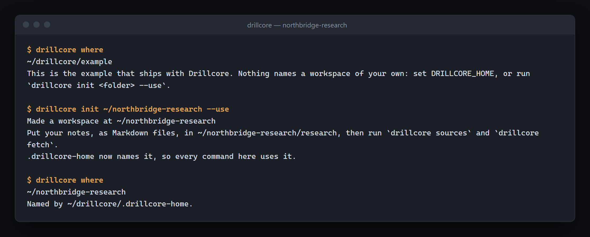
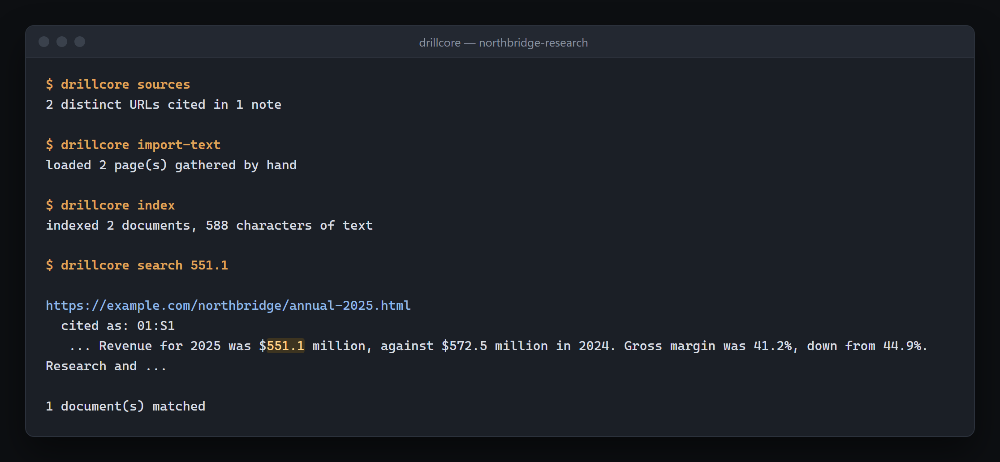
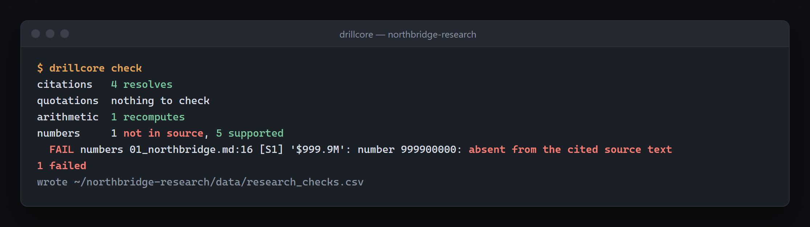
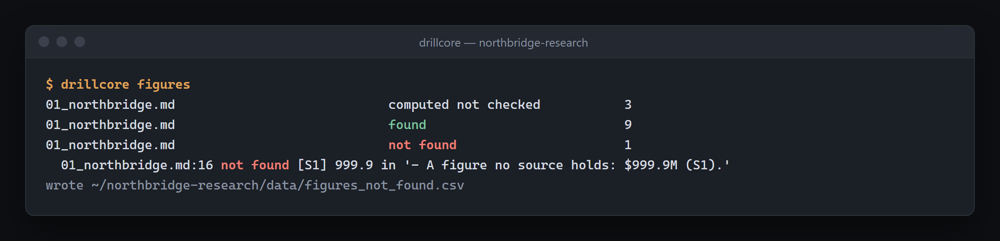
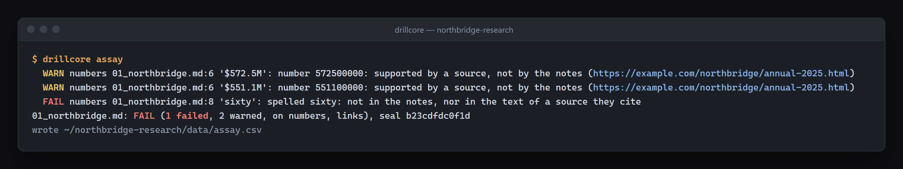

# Setting up Drillcore

This guide takes you from a fresh clone to a set of notes checked against their sources. Every screenshot here was made by running the commands on the fictional example workspace that ships in `example/`.

## What it's for

Research notes are full of figures: revenue, margins, headcounts, quotations, a percentage worked out from two other numbers. Each one came from somewhere, and by the time the notes become a report, that somewhere is easy to lose. A figure gets copied wrong, a quotation gets tidied, a source changes or disappears.

Drillcore's goal is that **every figure, quotation and calculation in a set of notes can be traced to a raw copy of the source it cites, and the ones that can't are caught before they reach a draft.** It does three things toward that:

1. **Keeps the sources.** It reads the notes, finds every address they cite, fetches each one once and keeps the raw bytes with where and when they came from. A source that later changes or vanishes is still there to check against.
2. **Checks the notes against them.** Every source key resolves to an address, every quotation appears word for word, every worked-out figure recomputes from its working, and every number in a sourced row is in the source that row names.
3. **Checks a draft against the notes.** Every figure in a draft must be in the notes as written, every link one the notes give, and no confidential name may appear.

It checks what you wrote. It never writes or rewrites the notes or the report for you.

## What you need

- **Python 3.11 or newer.** Nothing else: the core and the assay, the fact checker `check` and `assay` use, are the standard library only.
- **poppler's `pdftotext`**, if your sources include PDFs. Git for Windows ships it; on macOS `brew install poppler`, on Debian or Ubuntu `apt install poppler-utils`.

## 1. Get the code

```bash
git clone https://github.com/3DTHNeal/drillcore.git
cd drillcore
```

You can run it straight away with `python tools/drillcore.py --help`. To get a `drillcore` command on your path, install it into a virtual environment:

```bash
python -m venv .venv
.venv/Scripts/python.exe -m pip install -r tools/requirements.txt
.venv/Scripts/python.exe -m pip install -e .
```

On macOS and Linux the interpreter is `.venv/bin/python`. Every example below writes `drillcore`; `python tools/drillcore.py` does the same thing.

## 2. Make a workspace

The code and your research live apart. Your notes, the database and the fetched sources go in a **workspace**, a folder outside this repository, so nothing of yours can ever be committed by mistake.

With nothing set, every command reads the fictional example. Make a workspace of your own and point this clone at it:

```bash
drillcore init ~/northbridge-research --use
```



`--use` writes `.drillcore-home` in the clone, which git ignores. To pick a workspace for one run instead, set `DRILLCORE_HOME`. `drillcore where` always tells you which one is in use and what named it; run it before anything that writes.

A workspace looks like this once it's in use:

```
workspace.toml          settings: where the notes are, which companies to load from the SEC
research/*.md           your notes
checks/xbrl_claims.csv  optional: headline figures to hold against SEC facts
checks/waivers.csv      optional: findings you've judged and accepted, each with why, who and when
drafts/*.md             optional: drafts to hold against the notes
data/drillcore.db       the database, which Drillcore builds
data/raw/               one file for each page fetched, named by its hash
```

`init` makes `workspace.toml`, `research/` and `data/`. Add `checks/` and `drafts/` when you need them. Back up `data/`: the raw copies are the record of what a source said when you fetched it, and a page that has since changed can't be fetched again as it was.

## 3. Write notes it can read

Notes are Markdown files in `research/`. Drillcore reads figures in table rows and bullets, and each row names the source it comes from by a key. A **Sources** section gives each key its address:

```markdown
## 1. Results (S1)

| Item | 2025 | 2024 |
|---|---|---|
| Revenue, $M | 551.1 | 572.5 |
| Gross margin | 41.2% | 44.9% |

- The order book stood at $95.4M, of which $67.5M falls due within a year (S2).

## 2. Worked out

COMPUTED from the table above:

- Revenue change: -3.7% (551.1 against 572.5).

## Sources

- **S1.** Northbridge Robotics. 2026. *Annual Report 2025.* https://example.com/northbridge/annual-2025.html
- **S2.** Northbridge Robotics. 2026. "Order book update." https://example.com/northbridge/orders.html
```

- A row cites a key by writing it, or inherits the keys named in its section's heading or the line leading into it.
- Rows marked COMPUTED or derived are arithmetic. They aren't looked for in a source; their working is recomputed instead.
- Write the working beside a worked-out figure, as `-3.7% (551.1 against 572.5)`, `70.8% (67.5 of 95.4)` or `$27.9M (= 95.4 - 67.5)`, or as an equation.
- Give a page or section after a key, as `(S1 p.47)`, `(S1 pp.47-48)` or `(S1 §Note 12)`, and the checks hold the row's figures and quotations to it. A page is counted from the front of a PDF or read as the number printed on it; a section is found by the line that starts with its heading.
- Say what a figure measures where a reader would: a table's column headings (`Q3 2025`, `9M 2025`, `FY2025`) and row labels, or a period in the sentence. `figures` reads them to tell the right number for the wrong period or line from the right one.

`example/research/01_northbridge.md` is a complete note to copy from.

## 4. Gather the sources

```bash
drillcore sources      # record every address the notes cite
drillcore fetch        # download each one once and extract its text
drillcore index        # build the full-text index
drillcore search 551.1 # look for a figure across everything fetched
```



`fetch` identifies itself by a declared client name, waits between requests to one host, and fetches each address only once. A site that refuses an automated client is recorded as refusing; Drillcore doesn't disguise itself or try another way round. For those pages, save the text yourself and load it with `import-text`. It reads `data/raw/browser_capture.jsonl`, one JSON object a line:

```json
{"url": "https://example.com/northbridge/orders.html", "title": "Order book update", "text": "The order book stood at $95.4 million ...", "captured_at": "2026-11-10", "method": "by hand"}
```

The example's addresses are made up, so the screenshot above loads their text that way.

A source that is JSON, such as a price series, is kept but not read as text until you say the notes take their figures from that very file, by listing its address in `workspace.toml`:

```toml
[sources]
read_json = ["https://example.com/northbridge/prices.json"]
```

`fetch` then writes each value in the file as a line of text, unchanged. A copy already fetched is read where it's kept, not fetched again. Leave an address unlisted when it stands for more than its own file, as one address of a data service given as the source of everything the service holds: those figures are `claims`'s to check.

A cited SEC filing index brings in the documents inside the filing. To load the structured facts a company tags in its filings, list it in `workspace.toml` and run `drillcore sec`:

```toml
[[sec.company]]
cik = 1234567           # the SEC's identifier for the filer, from its EDGAR page
name = "Example Corp"
```

## 5. Check the notes

```bash
drillcore check
```

`check` runs four checks on every note, each against the sources a line cites: citations, quotations, arithmetic and numbers. It writes what didn't pass to `data/research_checks.csv` and exits 1 on any failure, so it can gate a script or a commit hook. Its last lines say how much of the notes it held to a source: a row that cites no source, or one whose source hasn't been fetched, isn't judged, and a run that judged nothing exits 1 too.

Warnings are listed but don't fail the run: a figure the source gives only away from every word the row uses for it, and an input to a worked-out figure that no checked row or cited source holds. To make every warning and every row not judged count, run `drillcore check --strict`, or set `strict = true` under `[check]` in `workspace.toml`. Then each must pass or be accepted with a row of `checks/waivers.csv`.



### Sections that must rest on a source

The count of what was held to a source is for the notes as a whole. When a note follows a framework, such as Five Forces, a section of judgment can pass with nothing under it while the results table carries the count. Name the sections that must rest on something a source holds, and how many lines under each must be held to one:

```toml
[[check.sections]]
notes = ["*_industry.md"]          # which notes; left out, every note
headings = ["Rivalry", "New entrants", "Substitutes", "Buyer power", "Supplier power"]
min_sourced = 2                    # lines under each heading held to a source; 1 when left out
```

`check` then has a `sections` line. A section with fewer lines held to a source fails as thin and says what's under it: lines citing no source, lines waiting on a source not yet fetched, lines with nothing to judge. A note the rule covers with no matching heading fails too. A heading matches without its number, its case or the keys in brackets at its end, so `## 4. Buyer power (S3)` is `Buyer power`. A section runs to the next heading at its level or above, so its sub-headings count toward it. A line counts when a quotation or figure on it was judged against its source, passed or not, since a figure that didn't hold up already fails on its own. A worked-out row counts once its inputs are traced.

The headings are yours. Drillcore doesn't supply a framework, or add a heading to a note. A section you accept as thin, such as one about suppliers that publish nothing, takes a waiver with `sections` as its check and the heading as its item. It lapses when any line of the section changes.

The example note deliberately holds a figure no source states, and `check` catches it. Each check can also run on its own: `citations`, `quotes`, `arithmetic`, and `figures`, a looser number check that says where it did find a near miss:



`figures` also reads what stands around a figure it finds. A figure the source holds only beside another period (Q3 where the note says nine months, 2024 where it says 2025) or another line (gross profit where the note says net) is listed as found beside another period or label, and one held only away from the page or section cited as not on the page cited. Where the source's words can't be read, the figure is found and nothing more is said.

Two more checks look across everything the workspace holds:

```bash
drillcore conflicts    # another source states a different figure for the same label and period
drillcore consistency  # the notes and drafts state one measure two ways
```

`conflicts` reads the tables in every source fetched, and for each figure a note takes from one source lists any other source that gives the same label and period a different figure. It names both and picks neither. `consistency` reads the tables and plain sentences ("Revenue for 2025 was $551.1M") of the notes and drafts, and lists each measure stated two ways beyond the rounding each is written to.

`drillcore claims` holds the headline figures in `checks/xbrl_claims.csv` against the SEC facts loaded by `sec`. It then works the notes' worked-out figures again from those facts as filed, where every input is a claim it matched, and lists the ones whose last digit changes, as warnings.

### Review each claim beside its source

```bash
drillcore review
```

`check` says what it found. `review` lets you look for yourself. It opens a page in your browser with the note on the left and the stored copy of the source it cites on the right, and steps through every claim `check` judges: each figure, quotation and worked-out figure, and each citation that didn't resolve.

- **Colours say the verdict.** In the note, each claim is marked red when it fails, amber for a warning, grey when it wasn't judged, violet when a waiver accepts it and green when it passes. Each verdict has a shape in the list as well, so colour isn't the only signal.
- **The source opens at the passage.** The figure or quotation is highlighted where the stored copy holds it, at whatever scale it was found (551.1 in the note, 551,102 in a table in thousands). The words the row describes it by are underlined nearby. When a key cites a page or a section, that stretch is shaded. Where the source holds a figure in several places, `[` and `]` step through them.
- **Corrections the source gives.** A quotation a word or two off is offered the words the source has at the closest passage. A worked-out figure that doesn't recompute is offered what its working gives. A figure on another page than the one cited is offered that page. Each offer shows the change word by word and is applied only when you press `s` or click Apply; `u` puts the line back. Nothing else is ever suggested: the review checks what you wrote, and doesn't write it for you.
- **Your judgment, kept.** `a` marks a claim as matching its source. `d` marks it as disagreeing, and asks what the source says instead. Marks go to `checks/review.csv` with your name and the date. A mark records the line and the source text it was made against, and asks you to look again once either changes.
- **Accepting a finding.** `w` writes a waiver for a failure or a warning, with your reason, to `checks/waivers.csv`, just as you'd write one by hand.
- **Your own edits.** `e`, or a double-click on any line, edits that line of the note, and the checks run again once it's saved.

`j` and `k` step through the claims, and `J` and `K` skip to the ones not yet marked; `?` lists every key. The list on the left can show only some verdicts, only the claims not yet marked, or the claims grouped by source.

The page is served from your computer to your computer only (`127.0.0.1`, port 8801 unless it's taken). It loads nothing from anywhere else, and only the page itself can send it a change. On the example workspace it shows everything and changes nothing.

## 6. Check a draft

Put the report you're writing in `drafts/`, as Markdown or as a Word document or PDF exported from wherever you write it, and run:

```bash
drillcore assay
drillcore proof
drillcore overlap
```

`assay` judges each draft against the notes. A number the notes don't hold fails; one only a cited source holds is a warning, and so is one the notes hold only on lines about something else. A figure is read as a writer states it: a unit a table's heading or a line's label gives once applies to the figures under it, "tenfold" is 10x, and 7.4% passes as a rounding of the notes' 7.36%, saying so. A title the notes don't give whole, such as "Senior Vice President" made from a senior engineer and a vice president, is a warning. Web addresses must be ones the notes give, or ones `[assay.accept_addresses]` names with a reason, and names listed under `[assay] forbidden` in `workspace.toml` must not appear, except where `[assay.allowed]` lets one stand.

`proof` holds a draft together: each citation such as "(Northbridge Robotics 2025)" must name an entry of the draft's reference list (or the files `[proof] references` names), and a narrative one such as "Roe et al. (2024) argue" a year the list gives that author (a warning), each cross-reference ("section 2", "Exhibit 1", "Appendix A") a heading or caption that exists, each exhibit be captioned once and mentioned, each Total add up, and nothing personal (a local path, an email, an account handle) be left in. It also warns when a figure of the executive summary appears nowhere else in the drafts, or when a sentence that points to "(sections 2.1 and 4)" gives a figure those sections don't, and when a figure isn't in the text of the source its sentence cites, unless the sentence labels it as the author's working ("author's calculation from ...") and a worked-out line of the notes gives it. `overlap` lists any run of 12 or more words a draft shares with a fetched source, outside quotations.

None of the three reads a draft's reference list as what the draft says, and none reads a section you name as a record, such as a log of prompts quoted word for word: list its heading under `[drafts] records = ["Appendix B"]`.



Here the draft says the company has "some sixty fewer" staff. The notes give 1,757 and 1,820 but never sixty, so the draft fails. (The two warnings in this picture are gone now: the notes give revenue as `551.1` in a table headed `$M`, and the draft's `$551.1M` is matched to that cell.)

## 7. Follow a figure, and keep the sources current

```bash
drillcore trace 551.1               # where a figure came from: draft line, note row, source, passage
drillcore trace 01_northbridge.md:6 # the same for every figure on a draft's line
drillcore evidence                  # a page for each draft, every figure linked to its passage
```

`trace` follows a figure back through each link: the draft lines that state it, the note row that holds it, the source key that row cites, the address with its fetch date and hash, and the passage in the stored copy with the figure marked. Where a link is missing it says where the chain stops. `evidence` writes the same for a whole draft, as a page in `data/evidence/` with each figure and quotation linked to its highlighted passage and the last findings of `assay` and `check` beside the lines they concern. Both read only the stored copies.

```bash
drillcore inventory   # every source, its status, hash and the lines citing it
drillcore recheck     # fetch each source again and say what changed
drillcore newer       # a later SEC filing follows, or restates, one the notes use
drillcore names       # a name spelled more than one way in the notes and drafts
```

`recheck` never replaces the copy the notes were checked against: a changed page is kept beside it, with a short diff of the text, and a page that's gone gets the Internet Archive's closest copy recorded as a second address. `newer` only warns. `names` reads spacing, hyphens, accents and case, and `[names] preferred` in `workspace.toml` holds a name to the spelling you want.

A source with no public address, such as a PDF from a data room or an email, can stand behind a key too: `drillcore import-file deck.pdf --key S7` keeps it by its hash and reads its text, and the Sources entry names it as `file:deck.pdf`. `export-sources` writes every Sources list as BibTeX and CSL JSON for a reference manager, and `import-sources` reads one back as proposed entries in `data/proposed_sources.md`, never into the notes.

## Day to day

A typical pass after editing notes:

```bash
drillcore sources && drillcore fetch && drillcore check
```

Every report goes to the workspace's `data/` folder as CSV. `check`, `citations`, `quotes`, `arithmetic`, `claims`, `conflicts`, `consistency`, `names`, `overlap`, `assay`, `proof` and `recheck` exit 1 when they find a problem, and `trace` when no chain reaches a stored passage, so any of them can stop a script. `figures`, `newer` and `inventory` only report.

A PDF fetched by an earlier version was read without its pages, so a page pinpoint on it isn't judged. `drillcore fetch --reread` reads it again with them.

`--reread` reads every copy as this version reads a page, so a page kept by a version that read what the page hides loses that text, and a row that passed on it then fails. Run `check` before and after, and keep a copy of `data/drillcore.db` first: the earlier text can't be read again. A page whose words a script lays out reads as no text at all. Gather its text by hand and load it with `import-text`; `--reread` leaves text loaded that way as it is.

## Troubleshooting

| You see | Do this |
|---|---|
| `This is the example that ships with Drillcore` | Nothing names your workspace. Run `drillcore init <folder> --use`, or set `DRILLCORE_HOME`. |
| `Python found a different package named assay` | An earlier setup installed the assay from Pyrite. `python -m pip uninstall pyrite-jobs`, then `python -m pip install -e .` |
| `fetched 0, failed N` | The reason is printed for each. A refusal stays recorded; gather that page by hand and run `import-text`. `fetch --retry-failed` tries the rest again. |
| `Some figures cite a source with no text yet` | Run `fetch`, or `import-text` for pages gathered by hand. |
| `Nothing in the notes was judged against a source` | No row cites a source whose text was fetched. Cite a key on each row with a figure, then run `sources` and `fetch`. |
| `... was fetched, and is JSON` | If the notes take figures from that file itself, list its address under `[sources] read_json` in `workspace.toml` and run `fetch`. Otherwise leave it: `claims` checks figures a data service tags. |
| `No SEC facts are loaded` | Run `drillcore sec` before `claims`. |
| A PDF source has no text | Install poppler's `pdftotext` and fetch again. |

## Working on the code

See [Work on it](../README.md#work-on-it) in the README and [CLAUDE.md](../CLAUDE.md) for the rules the code is held to.
